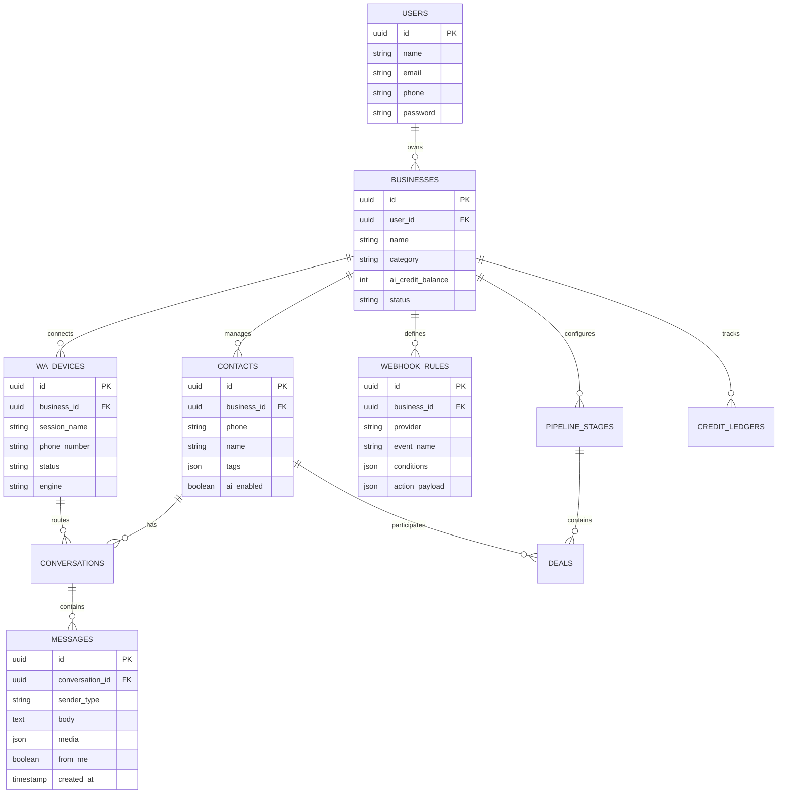

# Product Requirement Document (PRD)
## Poko: WhatsApp CRM & Chatbot AI Platform untuk UMKM Indonesia

---

## 1. Executive Summary & Product Vision

### 1.1 Visi Produk
**Poko** adalah platform SaaS *Omnichannel CRM & Chatbot AI* terpadu yang dirancang khusus untuk pelaku UMKM, pemilik bisnis online, dan tim sales/CS di Indonesia. Platform ini menduplikasi dan memodernisasi kemampuan kompetitor seperti **Ping!**, dengan arsitektur yang lebih ramping, hemat biaya, dan fleksibel:
* **WhatsApp Engine:** Menggunakan **WAHA (WhatsApp HTTP API)** via container Docker terisolasi untuk mengelola koneksi *multi-device* tanpa ketergantungan pada backend Baileys kustom yang rapuh.
* **AI Model Gateway:** Terintegrasi dengan **Sakelar AI Gateway**, memungkinkan pemilihan model dinamis (*DeepSeek-V3*, *GPT-6 Luna*, *Claude 3.5 Sonnet*, *Gemini 1.5*) dengan skema tagihan Rupiah terjangkau.
* **Unified Workspace:** Satu dashboard terpusat untuk inbox percakapan, manajemen database kontak, *sales pipeline* Kanban, siaran broadcast masal, otomasi follow-up, dan integrasi webhook e-commerce (Scalev, Lynk.id, Mayar).

---

## 2. Target Pengguna & Persona

| Persona | Kebutuhan Utama | Nilai yang Didapatkan dari Poko |
| :--- | :--- | :--- |
| **Owner UMKM / Bisnis Online** | Menghemat biaya CS, tidak ingin kehilangan prospek saat malam hari, tracking omset & pipeline order. | AI membalas 24/7 otomatis, order terdata rapi, broadcast promosi terjadwal. |
| **Admin / Customer Service** | Inbox obrolan terpusat, template balasan cepat (*Quick Reply*), mudah berkolaborasi tanpa rebutan chat. | Fitur *Takeover Mode* (matikan AI per kontak), multi-agent assign, tagging pelanggan. |
| **Digital Marketer / Media Buyer** | Mengirim follow-up lead dari iklan Meta / TikTok Ads CTWA, integrasi webhook checkout. | Otomatisasi pesan pemicu (*trigger*) saat checkout pending/paid di Scalev & Lynk. |

---

## 3. Tech Stack & Arsitektur Sistem

```mermaid
flowchart TD
    subgraph ClientLayer["Frontend & Client Layer"]
        A[Customer / WhatsApp User]
        B1["Dashboard Utama (Owner / Admin Console)"]
        B2["Aplikasi Chat Agen Terpisah (PWA / Web App)"]
        B3["Live Chat Widget (Website Pengunjung)"]
    end

    subgraph GatewayLayer["Perimeter & Edge"]
        CF[Cloudflare CDN / WAF / SSL]
        REV[Laravel Reverb WebSocket Server]
    end

    subgraph AppLayer["Core Backend (Laravel 11 / Filament v3)"]
        AUTH[Auth & Multi-Tenancy Engine]
        CRM[Omnichannel Inbox & Contacts]
        PIPE[Sales Pipeline & Kanban]
        AIENG[Chatbot Context & Memory Engine]
        BC[Broadcast & Queue Dispatcher]
        WHK[Webhook Ingestion Scalev/Lynk]
    end

    subgraph ServiceLayer["External Microservices"]
        WAHA[WAHA Docker Container (WhatsApp Gateway)]
        SAKELAR[Sakelar AI Gateway (OpenAI Compatible API)]
        PAY[Duitku Payment Gateway]
        REDIS[(Redis Cache & Horizon Queues)]
        DB[(PostgreSQL / MySQL)]
    end

    A <-->|WhatsApp Protocol| WAHA
    WAHA -->|Webhook Event| WHK
    WHK --> AIENG
    AIENG <-->|Chat Completion| SAKELAR
    AIENG -->|Send Message| WAHA
    
    B1 <-->|HTTPS REST| AppLayer
    B2 <-->|Realtime Chat API| AppLayer
    B2 <-->|WebSocket Events| REV
    B3 <-->|Visitor Chat Stream| REV
    B3 <-->|REST API| AppLayer
    AppLayer --> DB
    AppLayer --> REDIS
    BC --> REDIS
    WHK --> PAY
```

---

## 3.1 Design System & UI Style Guide (Referensi Ronas IT)

Mengikuti referensi visual yang ditetapkan pengguna (*Ronas IT Warm Minimalist Design System*), antarmuka Poko meninggalkan tampilan *generic corporate dashboard* dan mengadopsi estetika premium, bersih, dan modern:

### A. Tipografi (Typography)
* **Font Utama:** **General Sans** (Geometric Humanist Sans-Serif).
  * Karakter: Bersih, proporsional, keterbacaan tinggi untuk angka metrik dan teks chat WhatsApp.
  * Fallback Font: `system-ui, -apple-system, BlinkMacSystemFont, "Segoe UI", Roboto, sans-serif`.
  * Hierarchy:
    * *Display H1 / Large KPIs:* 28px - 32px, Semibold (600) / Bold (700).
    * *Section Title / Card Header:* 16px - 18px, Medium (500) / Semibold (600).
    * *Body Text / Chat Bubble:* 14px, Regular (400), line-height 1.5.
    * *Metadata / Timestamps:* 12px, Regular (400), color muted.

### B. Palet Warna (Color Palette)
* **Charcoal Primary (`#1f1f1f`):** Warna teks utama, tombol aksi utama (*+ Add customer / Kirim Pesan*), dan highlight kartu aktif (*Active Deal Card*).
* **Warm Linen / Soft Cream (`#f6f7ed`):** Background aksen banner metrik atas, card status ringkasan, dan gelembung pesan masuk (*customer bubble*).
* **Soft Off-White Base (`#f4f4f4`):** Background container kanban, tab pill yang tidak aktif, dan border pemisah halus.
* **Surface Pure White (`#ffffff`):** Background kartu kanban individual, dropdown menu, modal dialog, dan sidebar input.
* **Muted Gray (`#8c9298`):** Teks pendukung, label tanggal, dan icon netral.

### C. Komponen Visual & Karakteristik UI:
1. **Header Metrik & Analitik (Top KPI Banner):**
   * Background kontras lembut berwarna Linen Warm Cream (`#f6f7ed`) dengan sudut lengkung halus (`border-radius: 20px`).
   * *Bar Chart Dinamis:* Mengombinasikan batang solid charcoal (`#1f1f1f`) untuk konversi berhasil dan batang arsir diagonal (*striped*) untuk prospek berjalan.
   * *Semicircular Radial Gauge:* Indikator persentase *closing rate* (misal: *68% Successful Deals*) dengan busur jarum jam minimalist.
   * *Stat Counter:* Angka besar bersih dengan tombol panah eksplorasi (`→`).
2. **Kanban Pipeline Board:**
   * Kolom kanban memiliki badge penghitung berpenanda arah (`12 ↑↓`, `17 ↑↓`).
   * Kartu prospek berbentuk rounded card (`#ffffff`) dengan border sangat tipis (`1px solid rgba(0,0,0,0.05)`).
   * Kartu prioritas tinggi dapat beralih ke mode *Dark Inverted* (`#1f1f1f` background dengan teks putih) untuk penekanan deal besar/closing.
3. **Sidebar Kiri (Navigation):**
   * Menu dikelompokkan dengan rapi: *Utama*, *Projects / Workspaces*, dan *Anggota Tim (Members List)* lengkap dengan avatar foto bulat dan subtitle jabatan.
   * Indikator aktif berupa background pill lembut dengan icon garis tipis (*Tabler / Feather Icons*).

---

## 4. Peta Menu & Navigasi Dashboard Lengkap (Sitemap)

Berikut adalah struktur menu sidebar dan header navigasi di dalam dashboard Poko:

```
┌──────────────────────────────────────────────────────────────────────────────────┐
│ [Logo Poko]  [Pilih Bisnis ▼]                 [Saldo AI: 450 Kredit]  [Profil ▼] │
├──────────────────────────┬───────────────────────────────────────────────────────┤
│ 📊 Dashboard             │                                                       │
│ 💬 Omnichannel Inbox     │                                                       │
│ 👥 Database Kontak       │                                                       │
│ 📋 Sales Pipeline        │                 AREA KONTEN UTAMA                     │
│ 📢 Broadcast & Follow-up │                                                       │
│ 🤖 Poko AI & Otomasi     │                                                       │
│ 🔗 Integrasi & Webhook   │                                                       │
│ 📱 WhatsApp Devices      │                                                       │
│ ⚙️ Pengaturan Bisnis     │                                                       │
└──────────────────────────┴───────────────────────────────────────────────────────┘
```

### 4.1 Rincian Menu Sidebar

1. **📊 Dashboard (Ringkasan Analitik)**
   * Widget Statistik: Total Pesan Masuk Hari Ini, Pesan Dibalas AI, Pesan Dibalas Manual CS, Nilai Pipeline Closing.
   * Grafik Trafik: Volume chat per jam dan tren konversi harian.
   * Status Perangkat: Status device WhatsApp aktif dan sisa AI Credit.

2. **💬 Omnichannel Inbox**
   * *Semua Chat:* Daftar seluruh obrolan aktif.
   * *Belum Terbaca:* Chat yang membutuhkan perhatian segera.
   * *Ditugaskan ke Saya:* Chat yang di-assign khusus ke CS yang sedang login.
   * *Filter Label:* Filter berdasarkan tag (*Hot Lead, Follow-up, Closing*).
   * *Live View:* Jendela obrolan real-time dengan tombol **AI On/Off Takeover**, Quick Replies, info kontak sidebar, dan attach media.

3. **👥 Database Kontak**
   * *Daftar Kontak:* Tabel nomor, nama, label, total belanja, tanggal chat terakhir.
   * *Kategori & Label:* Manajemen tag (*VIP, Reseller, Pending COD, Spam*).
   * *Import & Export:* Wizard import CSV/Excel & backup database kontak.
   * *Google Maps Lead Scraper:* Tool pencarian nomor prospek lokal berbasis kata kunci & kota.

4. **📋 Sales Pipeline (CRM Deals)**
   * *Kanban Board:* Kolom tahapan (*Lead Baru $\rightarrow$ Follow-up $\rightarrow$ Deal $\rightarrow$ Paid $\rightarrow$ Lost*).
   * *Rekap Pesanan & Cek Ongkir:* Cek tarif ongkos kirim JNE, J&T, SiCepat langsung di dashboard dan cetak invoice sederhana.
   * *Todo List CS:* Daftar tugas follow-up harian per staf.

5. **📢 Broadcast & Follow-Up**
   * *Kampanye Broadcast:* Buat pesan massal baru dengan Spintax dan filter label kontak.
   * *Jadwal Siaran:* Pesan terjadwal untuk hari & jam tertentu.
   * *Drip Follow-Up Otomatis:* Rangkaian pesan berkala setelah customer masuk ke pipeline.
   * *Riwayat & Laporan:* Tingkat keterkiriman (*Delivered, Read, Failed*).

6. **🤖 Poko AI & Otomasi**
   * *Pengaturan AI Poko:* Nama bot, persona, gaya bahasa, prompt utama bisnis.
   * *Knowledge Base (Data Training):*
     * Text FAQ (Tanya Jawab Umum).
     * Spreadsheet Katalog Produk (Katalog SKU, Varian, & Harga).
   * *Keyword Media Triggers:* Kirim gambar brosur/pricelist otomatis saat customer menyebut kata kunci tertentu.
   * *Playground AI:* Simulator chat di web untuk menguji jawaban Poko sebelum go-live.

7. **🔗 Integrasi & Webhook**
   * *Rules Webhook:* Builder logika *Trigger $\rightarrow$ Action* (Contoh: Order Scalev Masuk $\rightarrow$ Kirim WhatsApp).
   * *Preset Integrasi:* Scalev, Lynk.id, Mayar, Google Calendar.
   * *Local API Key:* Dokumentasi & token API untuk developer eksternal.

8. **📱 WhatsApp Devices**
   * *Daftar Perangkat:* Status koneksi multi-session WAHA (`WORKING`, `SCAN_QR`).
   * *Tambah Perangkat Baru:* Tombol popup modal QR Code WAHA live generator.
   * *Strategi Rotasi:* Pilihan algoritma distribusi nomor (*Sequence / Spin / Random*).

9. **⚙️ Pengaturan Bisnis & Akun**
   * *Profil Bisnis:* Nama toko, jam operasional, pesan di luar jam kerja.
   * *Manajemen Tim:* Tambah staf CS, role (*Owner / Admin / CS*).
   * *AI Credit & Billing:* Riwayat pemakaian kredit, paket langganan aktif, tombol Top-Up via Duitku QRIS.

---

### 4.2 Aplikasi Chat Terpisah Khusus Agen CS (Poko Omnichannel Standalone PWA)

Persis seperti arsitektur Ping! pada endpoint **`https://chat.ping.co.id/app/omnichannel-crm`**, Poko menyediakan aplikasi chat mandiri bertipe **Progressive Web App (PWA Standalone)** dengan rute **`/app/omnichannel-crm`**:

#### A. Spesifikasi Arsitektur PWA Standalone:
* **Manifest PWA (`/manifest-omnichannel.json`):**
  * `name`: *Poko Omnichannel CRM*
  * `short_name`: *Poko Chat*
  * `start_url`: `/app/omnichannel-crm`
  * `display`: `standalone` (berjalan tanpa address bar browser, terasa 100% seperti aplikasi native desktop/mobile).
  * `theme_color`: Mengikuti identitas brand.
* **Dual Theme Engine:** Dukungan bawaan **Dark Mode** (default untuk kenyamanan mata CS) dan **Light Mode**.
* **Keamanan Akses Agen:** Staf CS login melalui portal otentikasi `/omnichannel-crm/login` tanpa memiliki akses ke panel admin, omset keuangan, maupun konfigurasi API.

#### B. Fitur & Antarmuka Utama di `/app/omnichannel-crm`:
* **Tampilan 3-Kolom Responsif (WhatsApp Web / Slack Style):**
  * *Sidebar Obrolan:* Filter tab status (*Semua Obrolan, Menunggu Balasan, Ditugaskan ke Saya, Selesai/Resolved*), badge notifikasi pesan baru, dan indikator channel (WhatsApp / LiveChat).
  * *Area Percakapan Real-Time:*
    * Gelembung pesan pelanggan vs gelembung pesan agen (*custom bubble styling*).
    * Status centang pengiriman (*Sent, Delivered, Read*).
    * Lightbox / Fancybox untuk preview foto/dokumen resolusi penuh.
    * Pemutar pesan suara (*voice note*).
  * *Header Tindakan Cepat (Quick Action Bar):*
    * **Tombol Resolve Chat (`--omni-resolve-btn`):** Menandai percakapan telah selesai dan mengarsipkannya dari daftar antrean aktif.
    * **Tombol AI Assist / Takeover (`--omni-ai-btn`):** Sakelar cepat untuk meminta AI memberikan saran draf balasan atau mengambil alih jawaban otomatis.
    * **Assign Agent:** Memindahkan penanganan chat ke CS lain jika butuh eskalasi.
  * *Panel Kanan (Profil Pelanggan):*
    * Identitas WhatsApp / Nama Kontak.
    * Label / Tagging dinamis (*Hot Lead, VIP, COD, dsb.*).
    * Catatan Internal Tim (Internal Notes antar CS).
    * Pemindahan tahapan Sales Pipeline / Rekap Pesanan.

---

### 4.3 Widget Live Chat Website (Pengunjung E-Commerce)

Fitur embed widget untuk dipasang di landing page, toko online, atau web WordPress/Shopify klien:
* **Snippet 1-Baris JavaScript:**
  ```html
  <script src="https://cdn.poko.id/widget/poko-livechat.js" data-business-id="uuid-bisnis-anda"></script>
  ```
* **Karakteristik Widget:**
  * Tombol floating melayang di pojok kanan bawah website.
  * Pengunjung dapat langsung berinteraksi dengan AI Poko secara gratis 24 jam nonstop tanpa perlu membuka WhatsApp terlebih dahulu.
  * Jika pengunjung ingin berpindah ke WhatsApp, widget menyediakan tombol otomatis *"Lanjut Chat di WhatsApp"*.
  * Seluruh obrolan dari widget website mengalir langsung ke Inbox yang sama di Poko Dashboard dan Aplikasi Chat Agen.

---

## 5. Format Data, File Template, & Sintaks Variabel

Untuk memudahkan import data dan integrasi, berikut adalah format baku yang didukung oleh sistem Poko:

### 5.1 Format Spreadsheet Katalog Produk (Knowledge Base)
Format file: `.csv` atau `.xlsx` (Maksimal 10 MB):
```csv
SKU,Nama_Produk,Kategori,Harga,Stok,Deskripsi,Link_Checkout
POKO-01,Poko Starter,Software,147000,999,Paket 3 bulan 3 device WA,https://poko.id/pay/starter
POKO-02,Poko Bisnis,Software,547000,999,Paket tahunan 6 device WA,https://poko.id/pay/bisnis
KB-001,Hijab Voal Premium,Fashion,65000,50,Bahan voal premium adem tidak licin,https://toko.com/hijab
```

### 5.2 Format Spreadsheet Tanya-Jawab (FAQ)
```csv
Kategori,Pertanyaan,Jawaban_Baku
Operasional,Jam berapa toko buka?,Toko dan CS buka setiap hari pukul 08.00 - 21.00 WIB. Pemesanan via AI aktif 24 jam.
Pengiriman,Ekspedisi apa saja yang digunakan?,Kami menggunakan JNE, J&T, SiCepat, dan Anteraja. Bisa COD ke seluruh Indonesia.
Garansi,Bagaimana kebijakan retur produk?,Retur dapat diajukan maksimal 2x24 jam setelah barang sampai dengan menyertakan video unboxing.
```

### 5.3 Format Import Kontak
```csv
Nama,Nomor_WhatsApp,Email,Label,Kota,Catatan
Budi Santoso,6281802731947,budi@gmail.com,Hot Lead;Reseller,Surabaya,Minat paket tahunan
Siti Rahma,6281226300090,siti@yahoo.com,Langganan,Jakarta,Pernah beli 3x
```

### 5.4 Sintaks Variabel Pesan & Spintax
* **Variabel Dinamis:**
  * `{nama}`: Nama kontak pelanggan (misal: "Budi").
  * `{sapaan}`: Panggilan waktu otomatis ("Pagi", "Siang", "Sore", "Malam").
  * `{nomor_order}`: Nomor invoice/order dari webhook e-commerce.
  * `{total_belanja}`: Nominal rupiah transaksi.
* **Format Spintax (Anti-Ban Filter):**
  * Sintaks: `{Opsi 1|Opsi 2|Opsi 3}`
  * Contoh:
    ```text
    {Halo|Hai|Selamat {sapaan}} Kak {nama}!
    Pesanan dengan nomor {nomor_order} {sedang diproses|sudah kami siapkan}.
    {Terima kasih banyak sudah berbelanja di toko kami!|Semoga harimu menyenangkan!}
    ```

---

## 6. Alur & Panduan Onboarding Pengguna Baru (User Journey)

Saat pengguna pertama kali mendaftar, mereka akan dipandu oleh wizard interaktif **5-Step Onboarding**:

```
[ Step 1: Profil Bisnis ] 
          │
          ▼
[ Step 2: Hubungkan WhatsApp Pertama (Scan QR WAHA) ]
          │
          ▼
[ Step 3: Setup AI Poko & Input 3 FAQ Awal ]
          │
          ▼
[ Step 4: Uji Coba Chat di AI Playground ]
          │
          ▼
[ Step 5: Dashboard Aktif & Siap Menerima Pesan ]
```

### Rincian Tiap Langkah Onboarding:

* **Langkah 1: Setup Identitas Bisnis**
  * Form input: Nama Bisnis, Kategori Industri (Fashion, Kuliner, Properti, Jasa, dll.), Nomor Admin WhatsApp.
  * Hasil: Akun tenant bisnis pertama dibuat otomatis.

* **Langkah 2: Menghubungkan Nomor WhatsApp Pertama**
  * Dashboard memanggil `POST /api/sessions/start` ke container WAHA.
  * Modal visual menampilkan QR Code langsung di layar browser dengan timer hitung mundur dan status live polling.
  * Pengguna membuka WhatsApp di ponsel (*Perangkat Tertaut $\rightarrow$ Tautkan Perangkat*) dan memindai QR.
  * Begitu status sesi berubah menjadi `WORKING`, indikator checklist hijau muncul otomatis: *"Selamat! WhatsApp Anda berhasil terhubung."*

* **Langkah 3: Menghidupkan Asisten AI Poko**
  * Pengguna memilih gaya bahasa Poko:
    * *Santai & Ramah* (Cocok untuk toko fashion, skincare, f&b).
    * *Profesional & Elegan* (Cocok untuk B2B, konsultan, properti).
  * Pengguna mengisi form cepat:
    * Jam Operasional.
    * 3 Pertanyaan yang paling sering ditanyakan pembeli beserta jawabannya.
    * (Opsional) Langsung upload file Excel katalog produk.

* **Langkah 4: Simulasi di AI Playground**
  * Sebelum nomor aktif merespons customer asli, dashboard menampilkan widget simulasi obrolan *Playground*.
  * Pengguna mencoba mengetik pertanyaan seolah-olah menjadi pembeli untuk melihat bagaimana Poko menjawab berdasarkan data di Langkah 3.
  * Pengguna dapat langsung merevisi prompt atau jawaban jika dirasa kurang pas.

* **Langkah 5: Checklist Kesiapan & Go-Live**
  * Kartu status (*Ready to Launch Card*):
    * [x] WhatsApp Utama Terhubung.
    * [x] AI Poko Terlatih.
    * [ ] Mode Whitelist / Auto-Reply Aktif.
  * Tombol aksi satu klik: **"Mulai Aktifkan Auto-Reply Poko"**.

---

## 7. Skema Relasi Database (Entity Relationship Diagram)



---

## 8. Persyaratan Non-Fungsional (NFR)

1. **Keamanan & Privasi Data:**
   * Password di-hash menggunakan `bcrypt`.
   * Enkripsi session token dan API Key pihak ketiga di level database (*AES-256*).
   * Strict Whitelist & Blacklist filter untuk mencegah kebocoran chat grup atau intervensi chat pribadi tak sengaja.
2. **Kinerja & Skalabilitas:**
   * Webhook ingestion latency $< 150\text{ ms}$.
   * Eksekusi antrean pesan massal dibatasi (*throttling*) maksimal 1 pesan per 3–5 detik per device guna melindungi integritas akun WhatsApp dari *banning*.
3. **Reliabilitas:**
   * Restart otomatis container WAHA dan recovery koneksi WebSocket saat jaringan terputus.
   * Dead Letter Queue (DLQ) untuk webhook gagal agar dapat di-retry secara manual.

---

## 9. Roadmap Implementasi (Tahapan Pembangunan)

```
[ Phase 1: MVP Core ]
├── Setup Laravel 11 + Filament v3 + Multi-Tenancy
├── Integrasi WAHA Session Manager & Live QR Modal Viewer
├── Integrasi Sakelar AI Gateway & Memory Storage
└── Omnichannel Live Chat Inbox (Dasar)

[ Phase 2: CRM & Contact Management ]
├── Database Kontak, Label, & Tagging (Import/Export CSV)
├── Sales Pipeline Kanban Board
└── Manual Takeover Switch (AI On / AI Off)

[ Phase 3: Automation & Integrations ]
├── Webhook Rules Engine (Scalev, Lynk, Mayar)
├── Broadcast Engine & Anti-Ban Random Delay
└── Knowledge Base Uploader (FAQ & CSV Parser)

[ Phase 4: Monetization & Production Hardening ]
├── AI Credit Ledger & Billing Gate
├── Payment Gateway Duitku (QRIS & VA)
└── Production Deployment (Docker Swarm / Kubernetes / VPS)
```
